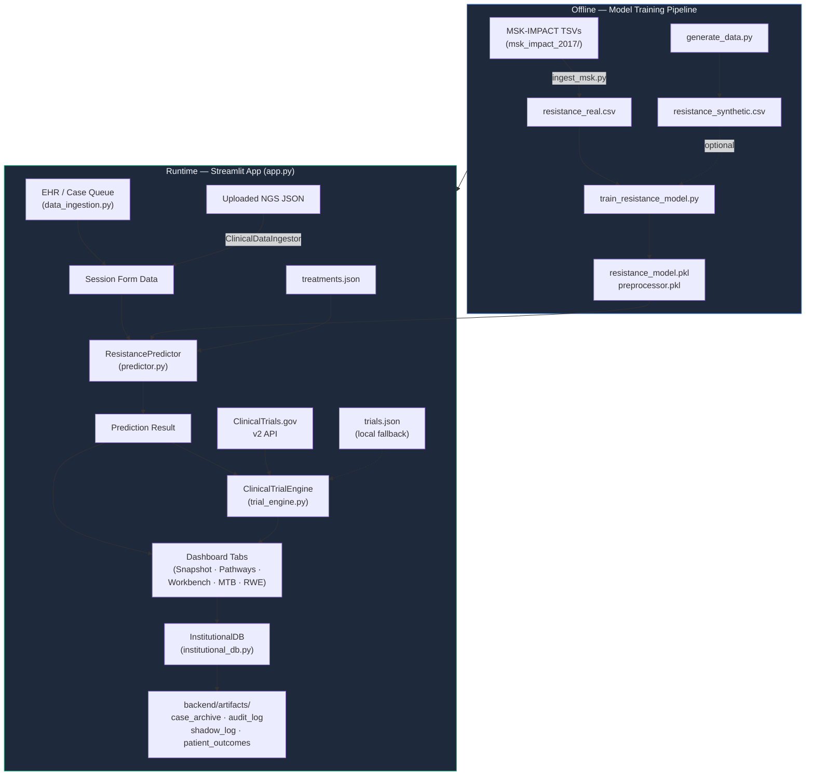
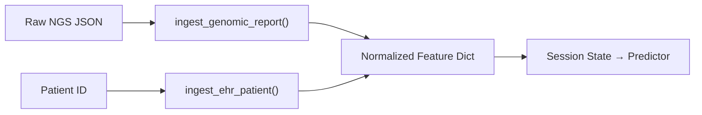

# ResistanceAI — Complete Data Flow Guide

> **One-sentence summary:** ResistanceAI ingests patient clinical and genomic data, runs it through a trained Random Forest model, enriches the results with a curated treatment knowledge base and live clinical-trial search, then surfaces the output on a Streamlit dashboard while persisting every action to a HIPAA-grade audit trail.

---

## Table of Contents

1. [System Purpose & High-Level I/O](#1-system-purpose--high-level-io)
2. [Architecture at a Glance](#2-architecture-at-a-glance)
3. [Offline Data Pipeline (Training)](#3-offline-data-pipeline-training)
4. [Runtime Data Flow (Inference)](#4-runtime-data-flow-inference)
5. [Component Deep-Dives](#5-component-deep-dives)
6. [Data Transformation & Validation Reference](#6-data-transformation--validation-reference)
7. [External Integrations](#7-external-integrations)
8. [File & Directory Map](#8-file--directory-map)

---

## 1. System Purpose & High-Level I/O

ResistanceAI is a **clinical decision-support platform** built for Molecular Tumor Boards (MTBs). It predicts how likely a patient's cancer is to resist standard-of-care therapy, then recommends biomarker-linked precision regimens.

### Major Inputs

| Input | Source | Format |
|---|---|---|
| Patient demographics & clinical history | Mock EHR (FHIR-like) | In-memory Python dict |
| Genomic/NGS reports | Uploaded JSON files | Illumina / Foundation-style JSON |
| MSK-IMPACT 2017 cohort data | Local TSV files (`msk_impact_2017/`) | cBioPortal tab-delimited |
| Medical knowledge base | `treatments.json` | Structured JSON |
| Live clinical trials | ClinicalTrials.gov v2 API | REST / JSON |

### Major Outputs

| Output | Destination | Format |
|---|---|---|
| Resistance risk score (0–100 %) | Streamlit dashboard | Numeric + visual gauge |
| Therapy recommendations | Streamlit dashboard | Structured cards with evidence tags |
| Matched clinical trials | Streamlit dashboard (live table) | DataFrame |
| MTB board packets & SOAP notes | Downloadable text files | Plain text |
| Audit trail, shadow logs, outcome records | `backend/artifacts/*.json` | JSON on disk |

---

## 2. Architecture at a Glance



---

## 3. Offline Data Pipeline (Training)

This pipeline runs **once** (or on-demand) to produce the serialized ML artifacts that power real-time inference.

### 3.1 Raw Data Ingestion — `ingest_msk.py`

```
MSK-IMPACT 2017 TSVs
  ├── data_clinical_patient.txt   (demographics, OS status)
  ├── data_clinical_sample.txt    (sample metadata, TMB)
  └── data_mutations.txt          (per-variant mutation calls)
            │
            ▼
      ingest_msk_data()
            │
            ├─ Merge patient + sample on PATIENT_ID
            ├─ Parse OS_MONTHS → define "resistant" label
            │     • Deceased + OS < 24 mo → resistant = 1
            │     • Living  + OS > 24 mo → resistant = 0
            ├─ Calculate C>T transition % per sample
            │     • Counts C→T and complementary G→A substitutions
            ├─ Flag HR Deficiency (BRCA1/2, ATM, PALB2, …)
            ├─ Bin TMB into tiers (tmb_1 … tmb_4)
            ├─ Map cancer type strings → canonical keys
            └─ Output ──▶ backend/data/resistance_real.csv
```

**Key functions:**

- `define_resistance(row)` — labels each patient resistant/non-resistant based on overall survival.
- `is_ct_transition(row)` — detects C>T (or G>A complement) single-nucleotide changes.
- `bin_tmb(val)` — buckets raw TMB into four ordinal tiers: `tmb_1` (<5), `tmb_2` (5–10), `tmb_3` (10–20), `tmb_4` (≥20).

### 3.2 Synthetic Data Generation — `generate_data.py`

Used to augment or replace real data during development. Produces 10,000 samples with clinically relevant feature correlations using cancer-type-specific probability distributions.

```
generate_synthetic_data(n_samples=10000)
        │
        ├─ Sample cancer_type with weighted distribution
        ├─ Draw age_at_diagnosis ~ N(62, 12), clipped [30, 90]
        ├─ Draw stage with [I=15%, II=25%, III=35%, IV=25%]
        ├─ Generate TMB via log-normal per cancer type
        ├─ Compute C>T % via Beta distribution
        ├─ Derive structural_variant_burden from TMB tier
        ├─ Sample hr_deficiency with site-specific probabilities
        ├─ Compute resistance probability:
        │     base_rate × stage_mult × tmb_mult × ct_mult × hr_mult
        │     → sigmoid sharpening to push toward 0/1
        └─ Output ──▶ backend/data/resistance_synthetic.csv
```

### 3.3 Model Training — `train_resistance_model.py`

```
train_pipeline()
        │
        ├─ load_data() ──▶ resistance_real.csv
        ├─ Split: 80/20, stratified on target
        ├─ Build preprocessor (ColumnTransformer):
        │     • Numeric  [age_at_diagnosis, ct_transition_pct] → StandardScaler
        │     • Categorical [cancer_type, tmb_level, sv_burden,
        │                    hr_deficiency, stage] → OneHotEncoder
        ├─ fit_transform(X_train), transform(X_test)
        ├─ Train RandomForestClassifier via RandomizedSearchCV:
        │     • 10 iterations, 5-fold CV, scoring = f1_macro
        │     • class_weight = balanced / balanced_subsample
        ├─ Evaluate: accuracy, ROC-AUC, precision, recall, F1
        └─ Serialize ──▶ backend/artifacts/
              ├── resistance_model.pkl   (~5 MB)
              └── preprocessor.pkl       (~2 KB)
```

**Why Random Forest?** Provides `feature_importances_` out of the box, which the dashboard uses for explainability treemaps and bar charts.

---

## 4. Runtime Data Flow (Inference)

Step-by-step walkthrough of what happens when a clinician selects a patient in the Streamlit sidebar.

### Step 1 — Application Bootstrap

```python
# app.py (lines 19–26)
@st.cache_resource
def load_clinical_resources():
    predictor   = ResistancePredictor(model_dir="backend/artifacts")
    inst_db     = InstitutionalDB()
    inst_db.seed_validation_data()    # 850-case demo cohort (runs once)
    trial_engine = ClinicalTrialEngine()
    return predictor, inst_db, trial_engine
```

`@st.cache_resource` ensures the **model**, **preprocessor**, **knowledge base**, and **database** are loaded exactly once and shared across all Streamlit re-runs within the same server process.

### Step 2 — Patient Selection & EHR Ingestion

```
Sidebar: Case Queue (CaseQueueManager)
        │
        ▼
  User selects patient (e.g., PX-8812)
        │
        ▼
  ClinicalDataIngestor.ingest_ehr_patient("PX-8812")
        │   Looks up patient in MOCK_EHR_DB dict
        │   Returns: {name, age, cancer_type, stage, hr_deficiency, detected_variants}
        ▼
  st.session_state.form_data.update(patient_data)
        │
        ▼
  trigger_inference()  ──▶ (Step 3)
```

Alternatively, a user can upload a raw NGS JSON report:

```
Uploaded JSON ──▶ ClinicalDataIngestor.ingest_genomic_report(file_content)
        │
        ├─ Parse biomarkers (TMB, HRD, signature weights)
        ├─ Extract detected variants (driver genes)
        ├─ Bin TMB into tier (tmb_1 … tmb_4)
        └─ Return normalized feature dict
```

### Step 3 — ML Inference (`predictor.py`)

```
trigger_inference()
        │
        ├─ Extract model feature keys from session form data
        ├─ Attach detected_variants list
        │
        ▼
  ResistancePredictor.predict_resistance(input_data)
        │
        ├─ _validate_input()
        │     Checks all 7 required features are present
        │
        ├─ preprocessor.transform(input_df)
        │     StandardScaler on numerics, OneHotEncoder on categoricals
        │
        ├─ model.predict_proba(X)[0][1]
        │     Probability of class 1 (resistant)
        │     Scaled to 0–100 → risk_score
        │
        ├─ _get_feature_contributions()
        │     Normalize model.feature_importances_
        │     Return top-10 features by weight
        │
        └─ _generate_interpretation(risk_score, input_data)
              │
              ├─ Assign risk tier: LOW (<40) / MODERATE (40–69) / HIGH (≥70)
              ├─ Natural language interpretation string
              │
              ├─ Knowledge Base Query:
              │     treatments.json → cancer_types → {site} → biomarkers
              │     ├─ Match each detected_variant against KB keys
              │     ├─ Check HRD_Positive flag (breast/ovarian)
              │     ├─ Check TMB-H flag (tmb_3 / tmb_4)
              │     └─ Universal: MSI-H (pan-cancer pembrolizumab)
              │
              ├─ Fallback: if no KB matches → "Institutional SoC (Chemotherapy)"
              │
              └─ Return: (risk_tier, interpretation, recommendation)
```

**Output structure:**

```json
{
  "risk_score": 72,
  "risk_tier": "HIGH",
  "probability": 0.72,
  "interpretation": "Predictive signature identifies high risk of therapeutic escape (72%).",
  "recommendation": {
    "summary": "Escalated monitoring recommended.",
    "therapies": [ { "name": "Osimertinib (Tagrisso®)", ... } ],
    "trials": [ { "id": "NCT00000000", ... } ]
  },
  "feature_contributions": [ { "name": "cancer_type_lung", "weight": 0.18 }, ... ]
}
```

### Step 4 — Clinical Trial Discovery (`trial_engine.py`)

Triggered on the **Pathways** tab whenever a patient has a prediction result.

```
ClinicalTrialEngine.fetch_trials(site, biomarkers, limit=50)
        │
        ├─ Check in-memory cache (keyed by site + biomarkers + limit)
        │     Hit? → return cached result (zero latency)
        │
        ├─ Build API params:
        │     query.cond  = mapped site name (e.g. "Lung Cancer")
        │     query.term  = biomarkers joined with " OR "
        │     pageSize    = limit
        │     filter.overallStatus = RECRUITING | NOT_YET_RECRUITING | ACTIVE_NOT_RECRUITING
        │
        ├─ GET https://clinicaltrials.gov/api/v2/studies
        │     timeout = 10s
        │
        ├─ _parse_api_response(data)
        │     For each study:
        │       Extract nctId, briefTitle, phases, overallStatus
        │       Normalize into internal schema
        │
        └─ On failure ──▶ _get_fallback_trials()
              Loads backend/knowledge_base/trials.json
              Filters by cancer site keyword match
```

### Step 5 — Dashboard Rendering (`app.py`)

The prediction result is visualized across **six tabs**:

| Tab | Data Shown | Key Libraries |
|---|---|---|
| 🎯 **Snapshot** | Risk score gauge, feature treemap, contribution bar chart | Plotly (treemap, bar) |
| 💊 **Pathways** | Therapy cards from KB, live trial table | HTML cards, DataFrame |
| 🧬 **Molecular Workbench** | Detected variants, CNV table, mutational signatures | DataFrame, Plotly bar |
| 📽️ **MTB Packet** | Board scheduling, SOAP note generation, decision capture | st.download_button |
| 📈 **Institutional RWE** | Kaplan-Meier survival curves, evidence ledger | Plotly line chart |
| 🧪 **Validation** | Retrospective batch engine, shadow tracking logs | DataFrame |

### Step 6 — Institutional Persistence (`institutional_db.py`)

Every significant action writes to disk via `InstitutionalDB`:

```
Action                          File Written                           Method
──────────────────────────────  ─────────────────────────────────────  ─────────────────────
Board resolution recorded       backend/artifacts/case_archive.json    archive_mtb_decision()
Shadow-mode AI prediction       backend/artifacts/shadow_log.json      log_shadow_entry()
Patient outcome follow-up       backend/artifacts/patient_outcomes.json record_outcome()
Any system event                backend/artifacts/audit_log.json       log_audit()
```

All files are **append-only** JSON arrays. Each entry is timestamped with `datetime.datetime.now().isoformat()`.

**Concordance calculation** (in `archive_mtb_decision`):

```python
concordance = 1.0 if ai_suggestion == board_choice else 0.0
```

This simple binary metric is aggregated in `get_institutional_performance()` and displayed on the RWE tab.

---

## 5. Component Deep-Dives

### 5.1 ClinicalDataIngestor (`backend/data_ingestion.py`)

**Responsibilities:** Parse external clinical data into the internal feature schema.



- `ingest_genomic_report()` extracts TMB, HRD status, driver variants, and structural variant burden from a JSON payload and bins them into model-compatible tiers.
- `ingest_ehr_patient()` simulates a FHIR-bridge lookup against a mock database of 10 patients with diverse oncology profiles.

### 5.2 ResistancePredictor (`backend/predictor.py`)

**Responsibilities:** Load trained model artifacts, validate input, run inference, and enrich output with medical knowledge.

Key design decisions:
- **Singleton pattern** via `get_predictor()` — avoids reloading the ~5 MB model on every call.
- **Knowledge base coupling** — the predictor owns the therapeutic recommendation logic, querying `treatments.json` by cancer site, variant, HRD status, and TMB level.
- **Graceful fallback** — if the model fails to load, a hard-coded mock result is returned so the UI never crashes.

### 5.3 ClinicalTrialEngine (`backend/trial_engine.py`)

**Responsibilities:** Fetch and normalize live trial data from ClinicalTrials.gov.

- **Caching:** Simple `dict`-based session cache keyed on `{site}_{biomarkers}_{limit}`. Prevents redundant API calls within a single app session.
- **Fallback:** If the API request fails (timeout, network error), the engine loads `backend/knowledge_base/trials.json` as a local safety net.

### 5.4 InstitutionalDB (`backend/institutional_db.py`)

**Responsibilities:** HIPAA-compliant persistence, RWE analytics, and validation data seeding.

- `seed_validation_data()` generates **850 demo cases** (170 per cancer site) with an 87.4% concordance rate and synthetic PFS data. This runs once on startup.
- `run_retrospective_study()` accepts a batch of historic cases and computes alignment rate — used in the Validation tab.
- `get_institutional_performance()` aggregates case archives and outcomes into dashboard-ready metrics.

### 5.5 Flask API (`backend/main.py`)

An **alternative entry point** (not used by the Streamlit app) that exposes the predictor via REST:

```
POST /predict   →  Validates JSON body (types, ranges, enums)  →  predict_resistance()  →  JSON response
GET  /health    →  { "status": "ok" }
```

Validation is more thorough than the Streamlit path: it checks field types, valid enum values, and numerical ranges (age 18–120, ct_transition_pct 0–100).

---

## 6. Data Transformation & Validation Reference

### Feature Schema (Model Input)

| Feature | Type | Valid Values | Transformation |
|---|---|---|---|
| `age_at_diagnosis` | int | 18–120 | StandardScaler |
| `ct_transition_pct` | float | 0–100 | StandardScaler |
| `cancer_type` | str | breast, lung, colorectal, melanoma, ovarian | OneHotEncoder |
| `tmb_level` | str | tmb_1, tmb_2, tmb_3, tmb_4 | OneHotEncoder |
| `structural_variant_burden` | str | low, moderate, high | OneHotEncoder |
| `hr_deficiency` | str | present, absent | OneHotEncoder |
| `stage` | str | I, II, III, IV | OneHotEncoder |

### TMB Binning Logic

```
Raw TMB value → Tier
  < 5 mut/Mb  → tmb_1 (Low)
  5–10        → tmb_2 (Intermediate-Low)
  10–20       → tmb_3 (Intermediate-High)
  ≥ 20        → tmb_4 (High)
```

This logic is applied identically in three places: `ingest_msk.py`, `generate_data.py`, and `data_ingestion.py`.

### Knowledge Base Lookup Priority

```
1. Exact variant match     (e.g., EGFR → Osimertinib)
2. HRD status              (HRD_Positive → PARP inhibitors)
3. TMB tier                (tmb_3/tmb_4 → Immunotherapy)
4. Universal biomarkers    (MSI-H → Pembrolizumab, pan-cancer)
5. Fallback                (No matches → Standard Chemotherapy)
```

---

## 7. External Integrations

### ClinicalTrials.gov v2 API

```
Endpoint:  https://clinicaltrials.gov/api/v2/studies
Method:    GET
Timeout:   10 seconds

Query Parameters:
  format              = json
  query.cond          = <mapped cancer site name>
  query.term          = <biomarker1 OR biomarker2 ...>
  pageSize            = <limit, default 50>
  filter.overallStatus = RECRUITING|NOT_YET_RECRUITING|ACTIVE_NOT_RECRUITING
```

No API key is required. Rate limiting is handled implicitly by the in-memory cache.

### Mock EHR Bridge (FHIR-like)

Currently simulated via an in-memory dictionary in `data_ingestion.py`. In a production deployment, this would be replaced with an Epic/Cerner FHIR R4 integration. The `ingest_ehr_patient()` method signature is designed to be a drop-in replacement point.

---

## 8. File & Directory Map

```
ResistanceAI/
├── app.py                          # Streamlit frontend (504 lines)
├── Dockerfile                      # Container deployment config
├── requirements.txt                # Python dependencies
├── sample_genomic_report.json      # Example NGS upload input
├── README.md                       # Project overview
│
├── backend/
│   ├── main.py                     # Flask REST API (alternative entry point)
│   ├── predictor.py                # ML inference + KB recommendation engine
│   ├── data_ingestion.py           # EHR + NGS report parsing
│   ├── institutional_db.py         # JSON persistence, audit, RWE analytics
│   ├── trial_engine.py             # ClinicalTrials.gov API integration
│   │
│   ├── models/
│   │   ├── ingest_msk.py           # MSK-IMPACT → training CSV
│   │   ├── generate_data.py        # Synthetic data generator
│   │   └── train_resistance_model.py  # RandomForest training pipeline
│   │
│   ├── knowledge_base/
│   │   ├── treatments.json         # Curated therapy KB (6 cancer sites)
│   │   └── trials.json             # Local fallback clinical trials
│   │
│   ├── data/
│   │   ├── resistance_real.csv     # Processed MSK-IMPACT training data
│   │   └── resistance_synthetic.csv # Generated synthetic training data
│   │
│   └── artifacts/
│       ├── resistance_model.pkl    # Serialized Random Forest (~5 MB)
│       ├── preprocessor.pkl        # Serialized ColumnTransformer
│       ├── case_archive.json       # MTB board decisions
│       ├── audit_log.json          # HIPAA audit trail
│       ├── shadow_log.json         # Shadow-mode AI predictions
│       └── patient_outcomes.json   # Post-treatment follow-up data
│
└── msk_impact_2017/                # Raw cBioPortal MSK-IMPACT dataset
    └── msk_impact_2017/
        ├── data_clinical_patient.txt
        ├── data_clinical_sample.txt
        ├── data_mutations.txt
        └── ... (77 files total)
```

---

> **Getting started?** Select a patient from the sidebar queue → the system auto-triggers inference → explore the six dashboard tabs to see how data flows end-to-end. For deeper dives, start with `predictor.py` (the brain) and `data_ingestion.py` (the mouth).
