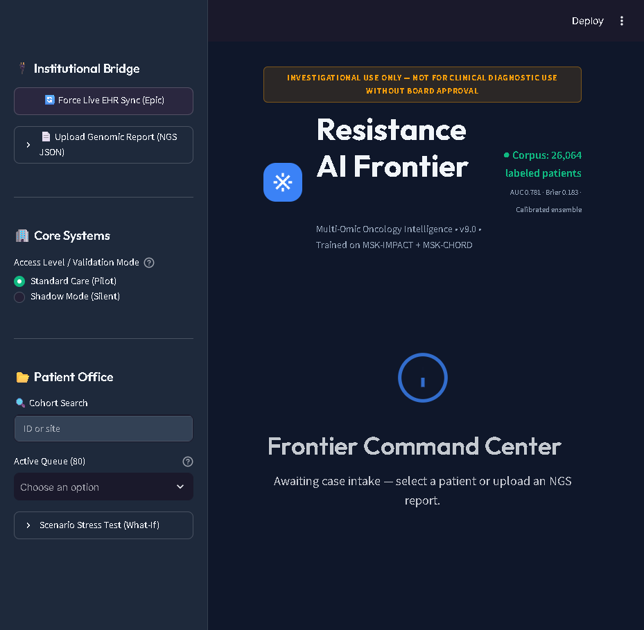
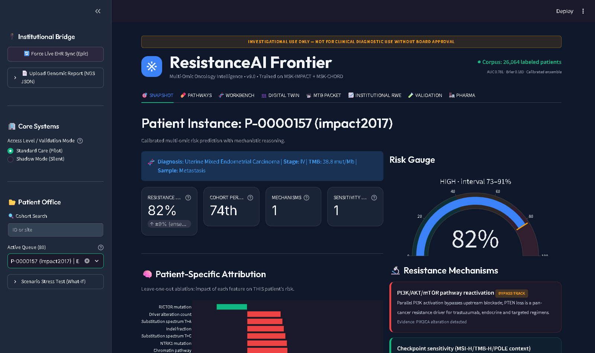
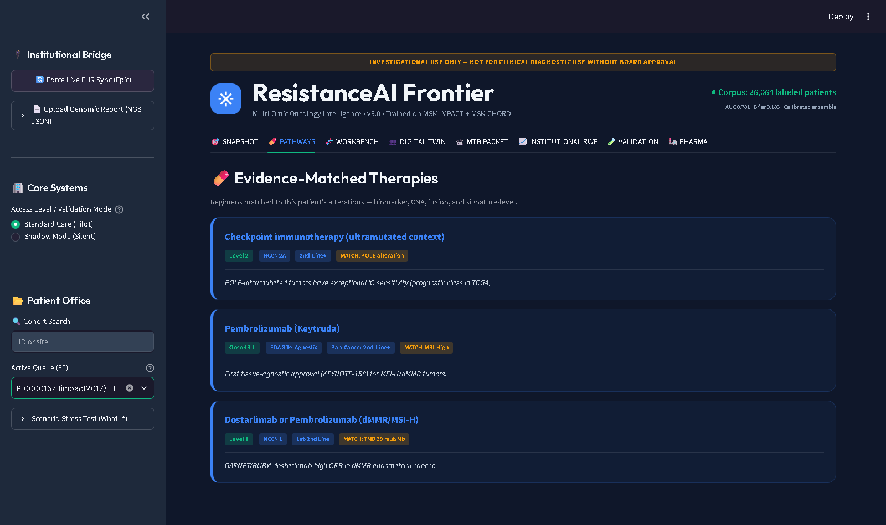
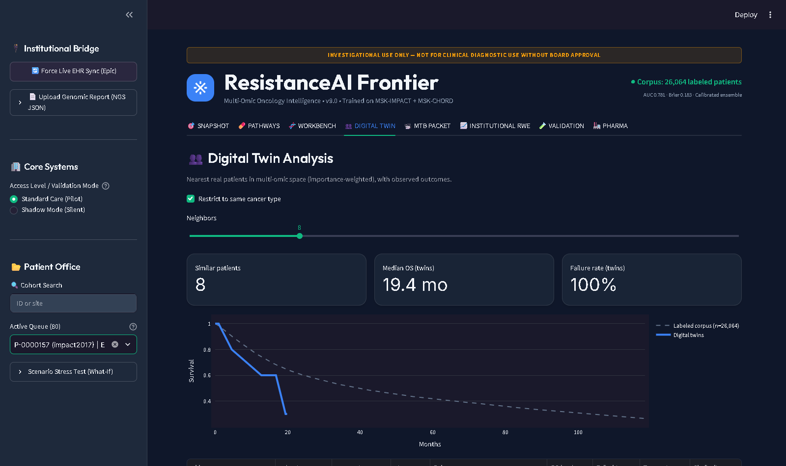
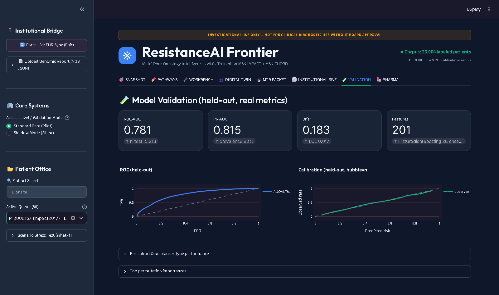

# ResistanceAI: Frontier Oncology Decision Support (v9.0)

ResistanceAI is a multi-omic clinical decision support prototype for Molecular
Tumor Boards. A calibrated ensemble model trained on **35,286 sequenced
patients** (MSK-IMPACT 2017 + MSK-CHORD 2024) predicts the probability of
treatment failure / early progression, explains *why*, and links the genomic
profile to evidence-ranked therapies and live clinical trials.

> **Investigational use only.** This is a research prototype. It is not a
> validated diagnostic device; all outputs require oncologist review.

## Screenshots

| Landing | Prediction snapshot | Therapy pathways |
|---|---|---|
|  |  |  |

| Digital twins | Model validation |
|---|---|
|  |  |

## Architecture

```
Raw cBioPortal studies          Engine                        Interface
─────────────────────           ──────────────────────────    ──────────────
msk_impact_2017/ ─┐             backend/models/ingest_v2.py   app.py (Streamlit, 8 tabs)
msk_chord_2024/ ──┴─►           backend/data/patient_records  backend/main.py (Flask API)
                    JSONL corpus (35,286 records, 26,064 labeled)
                              │
                              ├─ backend/features.py        shared feature schema (201 cols)
                              ├─ backend/models/train_v2.py HGB x8 + isotonic calibration
                              ├─ backend/predictor.py       calibrated inference + CI +
                              │                           ablation attribution + therapy match
                              ├─ backend/mechanisms.py      resistance-mechanism reasoning
                              ├─ backend/survival.py        Kaplan-Meier engine
                              ├─ backend/digital_twin.py    nearest-neighbor twin outcomes
                              └─ backend/cohort_analytics.py pharma cohort queries
```

## Key features

- **Calibrated risk, not a point score** — bagged 8-model HistGradientBoosting
  ensemble + isotonic regression; every prediction carries an ensemble-spread
  uncertainty interval and a cohort-percentile placement.
- **Patient-specific attribution** — leave-one-out ablation shows which
  alterations drive *this* patient's risk (permutation importance for the
  population view).
- **Mechanism reasoning** — rule-based hypotheses for escape pathways
  (e.g. ESR1 → endocrine resistance, STK11/KEAP1 → immune evasion).
- **Digital twins** — importance-weighted nearest neighbors drawn from the
  real corpus, with their observed survival curves.
- **Pharma analytics** — trial-feasibility cohort queries (biomarker ×
  histology × TMB) over the full corpus with real co-alteration frequencies.
- **Real molecular workbench** — SNVs, CNAs, fusions and the COSMIC-style
  substitution spectrum per tumor, straight from the sequenced data.
- **Live trial discovery** — ClinicalTrials.gov v2 queries filtered by the
  patient's actual biomarkers.
- **Expanded therapy KB** — biomarker → regimen mappings across the major
  solid tumors with evidence levels and next-line resistance concepts.

## Data & training

| Cohort | Patients | Labels | Source |
|---|---|---|---|
| MSK-IMPACT 2017 | 10,336 | OS-derived | Zehir et al., Nat Med 2017 |
| MSK-CHORD 2024 | 24,950 | real treatment + OS timelines | Jee et al., Nature 2024 |

**Held-out performance (n=5,213):** ROC-AUC 0.781 · PR-AUC 0.815 ·
Brier 0.183 · ECE 0.017. Per-cohort and per-cancer-type breakdowns plus the
ROC/calibration curves live in the **🧪 VALIDATION** tab. Risk-stratum KM
curves and cohort percentiles are computed from **5-fold out-of-fold** and
**held-out test** predictions respectively — no patient is scored by a model
that saw their record.

Data provenance and licensing (incl. the CHORD CC BY-NC-ND restriction) are
documented in `DATA_SOURCES.md`.

## Reproduce

```bash
# 1. environment
python -m venv .venv && .venv/Scripts/activate   # or source .venv/bin/activate
pip install -r requirements.txt

# 2. (optional) re-fetch CHORD mutations/SVs via cBioPortal API
python backend/models/fetch_chord_api.py

# 3. unified corpus
python backend/models/ingest_v2.py        # -> backend/data/patient_records.jsonl

# 4. train + calibrate + metrics
python backend/models/train_v2.py         # -> backend/artifacts/

# 5. run
streamlit run app.py                       # UI on :8501
python backend/main.py                     # REST API on :5000 (/health /predict /model/info /cohort/query)

# 6. tests — pure-logic layer (no corpus or model artifact needed)
python -m unittest discover -s tests -v
```

## Deploy

**Important — a public demo cannot ship the working model.** The trained
weights and the derived corpus are CC BY-NC-ND derivatives of MSK-CHORD (see
`DATA_SOURCES.md`), so they cannot be committed to a public git repo or baked
into a public image. Any hosted deployment must supply them at runtime via
`RESISTANCEAI_MODEL_DIR`/`RESISTANCEAI_DATA_DIR` mounts — there is no way to
create a *working* public demo link that reads them from this repository.

**Streamlit Community Cloud** — point the app at `app.py` from a fork/clone of
this repo; `requirements.txt` + `.streamlit/config.toml` are already set up and
the app boots cleanly. **Caveat:** because Cloud apps can only read what is in
the repo, a public Streamlit link shows the landing page and the 8 demo
patients, but inference, real-patient worklist, digital twins and cohort
analytics stay disabled (no model artifact, no corpus). Only deploy this way
if the artifact/data mounts are provided privately.

**Working hosted demo (Docker + mounts)** — the intended path for a live
public link: run the image on a host that supports mounted volumes (Railway,
Render, Fly.io, HF Spaces, a VM):

```bash
docker build -t resistance-ai .
docker run -v /licensed/artifacts:/models -v /licensed/data:/data \
  -e RESISTANCEAI_MODEL_DIR=/models -e RESISTANCEAI_DATA_DIR=/data \
  -p 8501:8501 resistance-ai
```

`RESISTANCEAI_MODEL_DIR` must contain `resistance_model_v2.pkl` (+ the metrics
JSONs); `RESISTANCEAI_DATA_DIR` must contain `patient_records.jsonl` +
`feature_matrix.parquet` — all produced by steps 2–4 of Reproduce above. The
same variables work for the Flask API (`backend/main.py`).

**Local demo (one command after setup)** — `streamlit run app.py` is the
supported single-command path on a machine that already has the licensed
artifacts.

**Configuration** — all runtime settings are environment variables; see
`.env.example`.

**Notes**

- Raw study data, the derived corpus (`backend/data/*`), **and the trained
  weights** (`resistance_model_v2.pkl`) are **gitignored** — CHORD is
  CC BY-NC-ND, and the weights are a derivative of that data. Steps 2–4
  regenerate everything. Without the artifact the app still starts but
  inference is disabled until step 4 runs.
- `POST /predict`, `/predict/batch` and `/cohort/query` validate input shape
  (400 on malformed payloads) and can be locked behind an API key:
  `export RESISTANCEAI_API_KEY=<secret>` → requests then need
  `X-API-Key: <secret>`. Unset = open dev mode.
- The same endpoints carry per-client sliding-window rate limits
  (defaults 120/10/30 requests per minute for predict/batch/cohort;
  `RESISTANCEAI_RL_PREDICT`, `RESISTANCEAI_RL_BATCH`,
  `RESISTANCEAI_RL_COHORT`; `0` disables). Behind a reverse proxy set
  `RESISTANCEAI_TRUST_PROXY=1` so client IPs come from `X-Forwarded-For`.
- CORS is dev-open by default; restrict before deploying:
  `export RESISTANCEAI_CORS_ORIGINS=https://mtb.hospital.org`.
- `/cohort/query` returns aggregate statistics only. Cohorts of <5 patients
  return counts but have outcome/genomic detail suppressed
  (`suppressed_small_n`) so individuals cannot be re-identified.
- `.dockerignore` keeps raw data, the corpus, the weights, and runtime logs
  out of images — mount licensed artifacts at runtime (see Deploy above).
  Without `RESISTANCEAI_DATA_DIR` (`patient_records.jsonl` +
  `feature_matrix.parquet`), corpus-backed features (digital twins, cohort
  analytics, the real-patient worklist) are unavailable while inference
  still works.
- **Patient identity.** IMPACT and CHORD share the same `P-XXXXXXX` id
  namespace (~4.2k patients collide), so every consumer keys records by a
  cohort-qualified uid — `impact2017:P-0001234` vs `chord:P-0001234` are two
  different patients. The worklist, EHR lookup, twin table, and
  `feature_matrix.parquet` all carry the qualified uid; bare ids are treated
  as ambiguous, never silently joined.

## Honest limitations

- The prediction interval is ensemble disagreement — a model-uncertainty
  proxy, not a calibrated coverage guarantee.
- Retrospective, single-system (MSK) training data — prospective multi-site
  validation has not been performed.
- The "resistance" label is a survival/timeline-derived proxy (treatment
  failure, early progression), not a pathology-confirmed event.
- Partial label leakage: CHORD only ships `STAGE_HIGHEST_RECORDED` (max stage
  across the disease course), so `stage_ord`/`is_metastatic` can encode
  post-baseline progression for patients who advanced after sequencing.
  That feature is the model's top predictor — held-out AUC is mildly
  optimistic. See `DATA_SOURCES.md`.
- CHORD data is CC BY-NC-ND — commercial deployment requires an MSK license.
- Audit logs are local JSON — a production deployment needs real IAM, PHI
  controls, and a compliant store before any "HIPAA-grade" claim applies.

---
**Disclaimer:** For investigational use only. All findings must be validated
by a board-certified oncologist.
